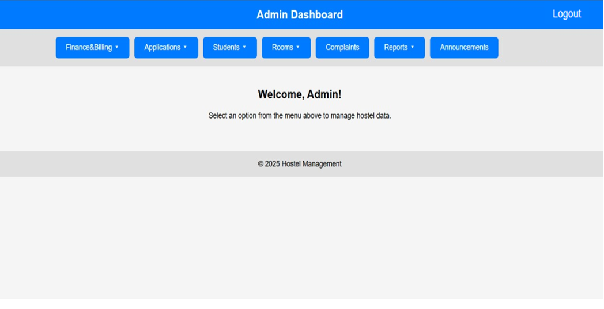
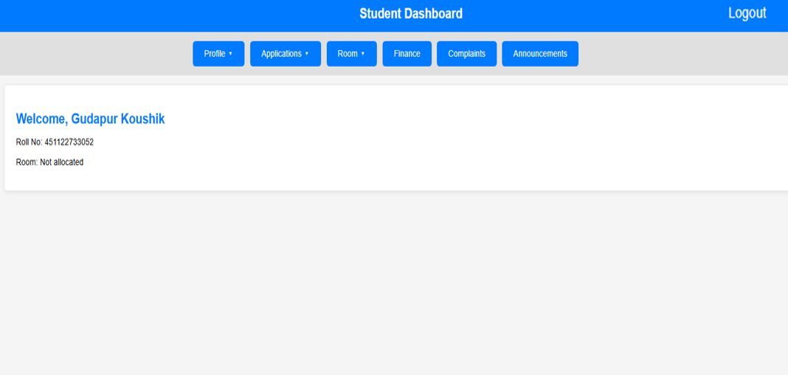
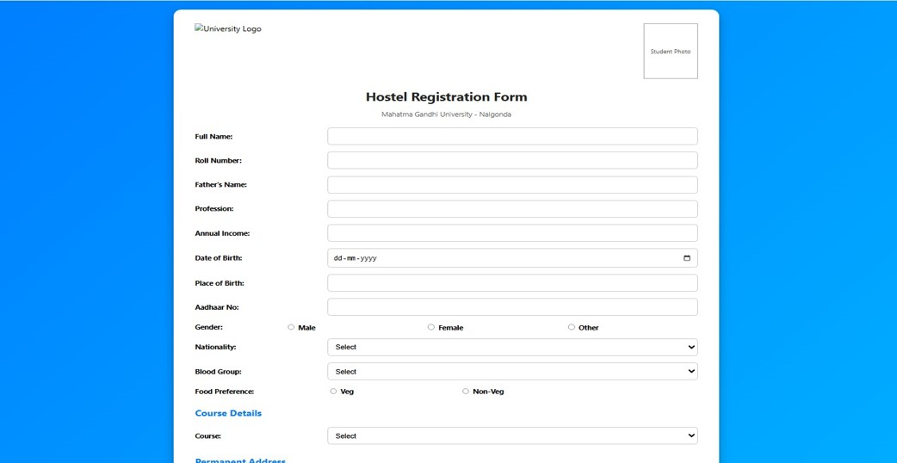
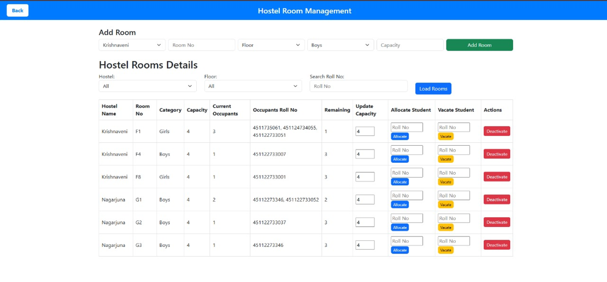
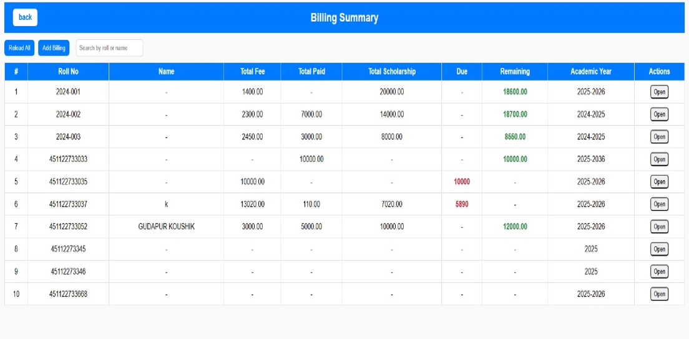
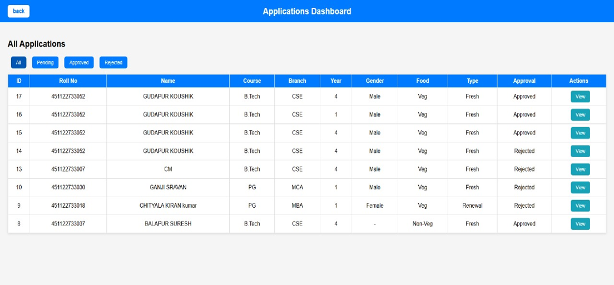

# Hostel Management System

A web application for managing hostel admissions, room allocation, fees and
student complaints, with separate admin and student logins.

## Features

**Admin**
- Approve or reject hostel applications, with a rejection reason
- Add rooms and track room status
- Allocate rooms to students
- Manage student records and fee billing
- Post announcements and notices
- Receive security alerts for repeated failed logins

**Student**
- Apply for hostel accommodation (with photo and certificate upload)
- View allocated room and fee details
- File complaints and track their status (Pending / In Progress / Resolved)

## Security
- Passwords hashed with bcrypt
- Role-based access (admin vs student)
- Account lockout for 15 minutes after 3 failed logins, with an admin alert
- Secrets kept in environment variables

## Tech Stack
Node.js, Express, MySQL, EJS, HTML, CSS, JavaScript

## Database
12 tables, including users, hostel_applications, rooms, room_allocations,
student_billing and complaints. Schema is in `schema.sql`.

## Setup
1. Clone the repo and run `npm install`
2. Copy `.env.example` to `.env` and fill in your values
3. Create the database and run `schema.sql`
4. Start the server with `npm start`

## 📸 Screenshots

### 1. Admin Dashboard

### 2. Student Dashboard

### 3. Hostel Registration Form

### 4. Room Allocation

### 5. Billing

### 6. Application

## Future Improvements
- React frontend
- Automated tests
- Cloud deployment
